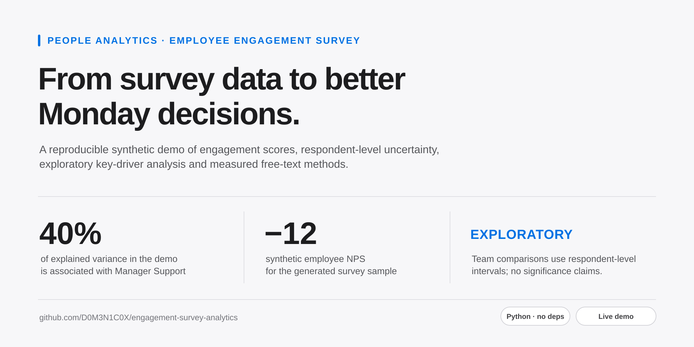
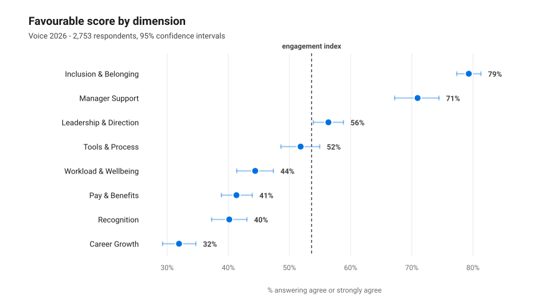
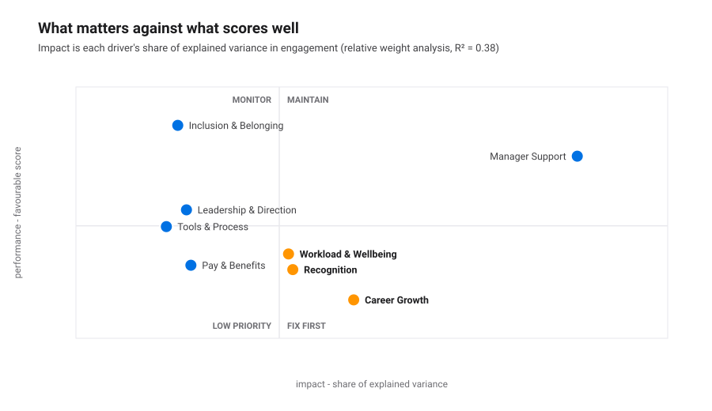
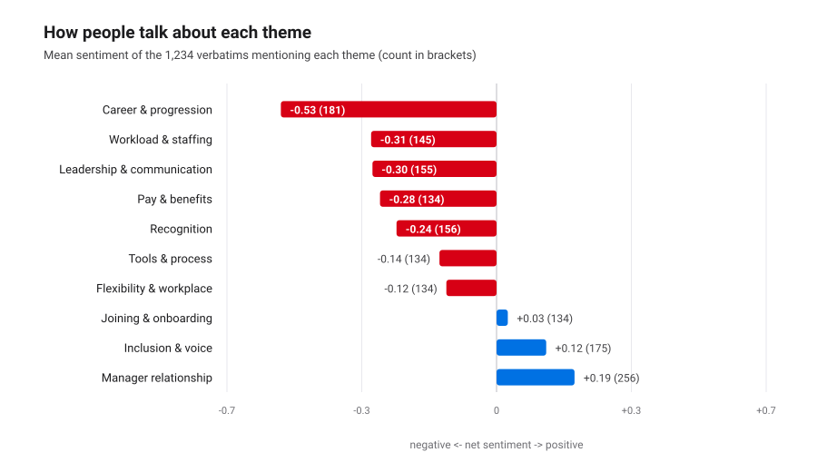

<picture>
  <source media="(prefers-color-scheme: dark)" srcset="site-assets/cover-dark.svg" type="image/svg+xml">
  
</picture>

<p align="center">
  <a href="https://d0m3n1c0x.github.io/engagement-survey-analytics/"><b>Open the live dashboard</b></a> ·
  <a href="reports/survey_report.md">Read the read-out</a>
</p>

<p align="center">
  <a href="https://github.com/D0M3N1C0X/engagement-survey-analytics/actions/workflows/ci.yml"></a>
  
  
  
</p>

## Why this matters

This repository now has two clear paths: a reproducible synthetic demo and a separate local-only
CSV analysis workflow. The read-out covers participation, respondent-level scores, exploratory
key-driver analysis and measured free-text methods. It remains an analysis prototype, not a
hosted or validated production HR service.

> **Synthetic data.** The survey, the answers and the comments are generated with a fixed
> seed by [`src/generate_survey.py`](src/generate_survey.py). No real employee wrote any of
> this. What is meant to be judged is the method.

---

## The interactive part

`dashboard.html` is the synthetic demo: filter by department, country, level, tenure or work
model, and the scores, confidence intervals, eNPS and themes recompute in the browser. It is
self-contained, with no server, libraries or build step.

```bash
python3 src/run_all.py && open dashboard.html
```

It also enforces a minimum group size of five for reported scores and hides the exact count
when a filter falls below that threshold. The demo is synthetic; this interface safeguard
does not make a real-data HTML file anonymous or prevent access to its embedded payload.

## Analyse a survey locally

The public workflow above regenerates only the synthetic demo. For a private CSV export,
run the separate local entry point. It reads files on your computer and makes no network
requests:

```bash
python3 src/local_run.py \
  --data-dir /secure/path/survey-csv \
  --output-dir /secure/path/new-analysis-folder \
  --survey-name "Employee survey" \
  --field-window "1-30 September 2026"
```

The input follows the schemas in [`data/README.md`](data/README.md): one row per invitee in
`survey_responses.csv`, matching survey instrument and team roster files, and the eight
supported driver dimensions. `survey_comments.csv` is optional. The optional
`comment_themes_truth.csv` is only for an independently labelled reference set. The tool
checks IDs, joins, score ranges and team sizes, then applies the minimum group size to
reported results. The eight-driver model runs only when at least 50 complete responses span
five or more teams; otherwise the report explains why it was skipped.
Use pseudonymous response IDs and keep both source and output folders outside this repository.
The output folder must be new or empty.

Local mode writes an aggregate Markdown report, SVG charts and an optional offline HTML
dashboard. The report omits raw comments and team identifiers. The dashboard omits free text
and rare filter labels, but embeds respondent-level scores and segment indexes to make its
filters work. It is confidential data, not anonymised data or an access-control mechanism;
store it only in an approved, access-controlled location. To avoid creating the dashboard,
add `--report-only`.

The five-person suppression rule is a product safeguard, not a GDPR guarantee. Review lawful
basis, purpose, retention, access and small-group disclosure risks with the organisation's
privacy specialist before using employee data.

---

## What the analysis found

**Participation is the first finding, not a footnote.** 72.4% responded — but 61% in
Operations against 83% in Finance & Legal, and 57% among shift workers against 79% at a desk.
Those gaps show who is represented; they do not tell us what non-respondents would have said.

**The headline is an engagement index of 54% favourable and an eNPS of −12.** Career Growth
scores lowest at 32% favourable, Inclusion & Belonging highest at 79%.



**But what scores badly and what matters are different questions.** A relative weight
analysis (Johnson's method — the drivers are far too correlated for raw regression
coefficients) splits the 38% of explained variance across the eight dimensions:



- **Manager Support carries 40% of the explained variance** — nearly three times the
  bottom four dimensions combined (14%) — and came first in *every one* of 120 bootstrap
  resamples.
- **Career Growth (19% impact, 32% favourable) and Recognition (14%, 40%)** sit in the
  fix-first quadrant: high impact, low score.
- **Pay & Benefits scores 41% favourable and carries 4% impact.** Pay is the loudest theme
  in the free text and near the bottom of the scores, and it still is not what separates an
  engaged employee from a disengaged one here. That is an uncomfortable finding to present,
  which is exactly why it ships with a bootstrap behind it.

**The company average hides the teams.** Across 86 teams with at least 15 respondents, the
respondent-level engagement index runs from 18% to 94%; its bottom decile is 29% against 80%
at the top. Nineteen teams have a 95% bootstrap interval below the observed company mean. This is an
exploratory screen, without multiplicity adjustment, and the company mean includes those
teams. Teams in the top quartile on Manager Support score 72% against 36% in the bottom
quartile, a 37-point descriptive gap inside this synthetic company.

**The free-text pattern is exploratory.** Across 44 eligible department-and-theme
combinations, the share of distinct commenters raising a theme correlates **r = −0.55** with
the favourable score on the mapped dimension. This is a descriptive cross-check, not
independent validation or evidence that commenters represent the workforce.



---

## The part most survey projects skip: scoring the text pipeline

Themes come from a keyword lexicon and sentiment from a word list with negation handling —
both in [`src/textlib.py`](src/textlib.py), both readable and arguable, because anything an
HR team publishes from free text has to survive the question *"how did you decide that?"*.

Neither is trusted without a measurement. The generator writes out which themes each comment
was built from, and the analysis scores itself against those labels before quoting anything:

| Measure | Result |
|---|---|
| Comments tagged with at least one theme | 97% of 1,234 verbatims |
| Macro F1 across ten themes | **0.93** |
| Weakest theme (Manager relationship) | comments that mention a manager in passing get pulled in |
| Sentiment vs the labelled tone | 67% of negative, 71% of positive comments correct |
| Respondent's average comment sentiment vs their own eNPS (descriptive) | **r = 0.28** |

That correlation is descriptive and not an external validation. The text pipeline does not
judge an individual employee or comment.

And the F1 has a ceiling of its own worth stating: the verbatims are assembled from a
template bank, so a keyword lexicon has an easier job here than it would on real free text.
The evaluation proves the pipeline is *measured* and that its weak spot is known — not that
0.93 would survive contact with a real corpus.

---

## Method notes

- **Team-cluster bootstrap intervals** for company and department means when multiple teams
  contribute; one-team subsets fall back to resampling respondents. Team scores resample people
  within the team. Each person contributes one mean score per measure, so a respondent with more
  answered items does not count as more independent evidence.
- **Descriptive group comparisons** for departments and teams. No significance claim is
  made, and the team intervals are not adjusted for multiple comparisons.
- **Johnson's relative weights** for driver impact, plus **120 team-cluster bootstrap resamples**
  to show which parts of the ranking are stable. The report says explicitly which dimensions swap
  places and should not be argued about.
- **A five-respondent reporting threshold** for score cells and theme contributors. The
  public dashboard embeds synthetic row-level answers. Local mode omits text and rare filter
  labels, but its HTML still embeds respondent-level scores; this is confidential data, not
  anonymised data or an access-control mechanism.
- **Association, not causation.** Cross-sectional survey data cannot prove that improving a
  driver raises engagement; the report says so wherever a number could be read as a promise.

Everything is implemented from scratch in [`src/statlib.py`](src/statlib.py) — including a
Jacobi eigenvalue solver, since relative weight analysis needs to decompose the predictor
correlation matrix.

---

## What's inside

```
├── dashboard.html                one self-contained interactive file
├── src/
│   ├── generate_survey.py        synthetic survey: instrument, answers, verbatims
│   ├── surveylib.py              favourable scoring, eNPS, segments, the confidentiality gate
│   ├── statlib.py                cluster bootstrap, OLS, Jacobi eigen, relative weights
│   ├── textlib.py                tokeniser, theme lexicon, sentiment, TF-IDF, redaction
│   ├── viz.py                    dot plot with CIs, heatmap, quadrant, diverging bars
│   ├── analysis_scores.py        module 1 - participation and scores
│   ├── analysis_drivers.py       module 2 - key driver analysis
│   ├── analysis_text.py          module 3 - free text, scored before it is believed
│   ├── build_dashboard.py        payload + HTML + JS for the dashboard
│   ├── run_all.py                synthetic demo pipeline
│   └── local_run.py              validated local CSV workflow
├── data/                         generated CSVs + data dictionary
└── reports/
    ├── survey_report.md          the written read-out
    └── figures/                  6 SVG charts
```

Four tables: the invite list with every answer, the free-text verbatims, the team roster and
the questionnaire itself. Column-by-column definitions — and an honest list of the effects
deliberately planted in the generator — are in [`data/README.md`](data/README.md).

## Run it

```bash
python3 src/run_all.py
```

Regenerates the data, runs the three analyses, writes six charts, assembles the read-out and
builds the dashboard. It took about 17 seconds in the tested environment. **No packages to
install** — Python 3.10 or newer and nothing else.

```bash
python3 -m unittest discover -s tests
```

runs the tests, also with no packages: bootstrap reproducibility, respondent-level scoring,
local CSV validation, the hand-written statistics against known values and their defining
properties, and every figure in the findings above against the read-out.

To publish the dashboard as a live page, enable GitHub Pages with "GitHub Actions" as the
source; [`.github/workflows/pages.yml`](.github/workflows/pages.yml) deploys it on every
push to `main`.

## About

Built by **Domenico Perroni** — HR advisory, people analytics and media education, based in Kraków.
[GitHub profile](https://github.com/D0M3N1C0X) · [LinkedIn](https://www.linkedin.com/in/domenico-perroni)

**More from the same portfolio**

- [pay-transparency-readiness-kit](https://github.com/D0M3N1C0X/pay-transparency-readiness-kit) — the EU Pay Transparency Directive run end to end for an employer in four countries: a live Excel model reconciled with pandas, a board briefing and a readiness checklist, with the [report online](https://d0m3n1c0x.github.io/pay-transparency-readiness-kit/)
- [where-pay-transparency-bites](https://github.com/D0M3N1C0X/where-pay-transparency-bites) — Eurostat data for all 27 Member States, analysed in R: the published gender pay gap understates the gap inside sectors, most of all where it looks small; [article](https://d0m3n1c0x.github.io/where-pay-transparency-bites/), [dashboard](https://d0m3n1c0x.github.io/where-pay-transparency-bites/dashboard/) and [working paper](https://d0m3n1c0x.github.io/where-pay-transparency-bites/paper.pdf)
- [workforce-cost-model](https://github.com/D0M3N1C0X/workforce-cost-model) — the people budget of the organisation in hr-people-analytics: Italian and Polish employer costs, the FY2026 budget variance and FY2027 scenarios in a live Excel model reconciled with pandas, with the [memo online](https://d0m3n1c0x.github.io/workforce-cost-model/)
- [equal-value-pay-ranges](https://github.com/D0M3N1C0X/equal-value-pay-ranges) — from family pay bands to one range per grade and country for the same organisation: Eurostat market pricing for four countries, a live Excel model reconciled with pandas, and a [pay range finder](https://d0m3n1c0x.github.io/equal-value-pay-ranges/ads.html) for job ads
- [hr-people-analytics](https://github.com/D0M3N1C0X/hr-people-analytics) — attrition drivers, EU pay-transparency exposure and HR service-desk performance on a synthetic 4,000-employee organisation, with the [report online](https://d0m3n1c0x.github.io/hr-people-analytics/)
- [job-search-agent](https://github.com/D0M3N1C0X/job-search-agent) — a job search run as a pipeline: public ATS board APIs, explainable fit scoring, funnel analytics
- [pompei-stratificata](https://github.com/D0M3N1C0X/pompei-stratificata) — Pompeii and Herculaneum from AD 79 to today, a [walkable model](https://d0m3n1c0x.github.io/pompei-stratificata/) with a sourced documentary dossier, in six languages

MIT licensed. Reuse anything here.
