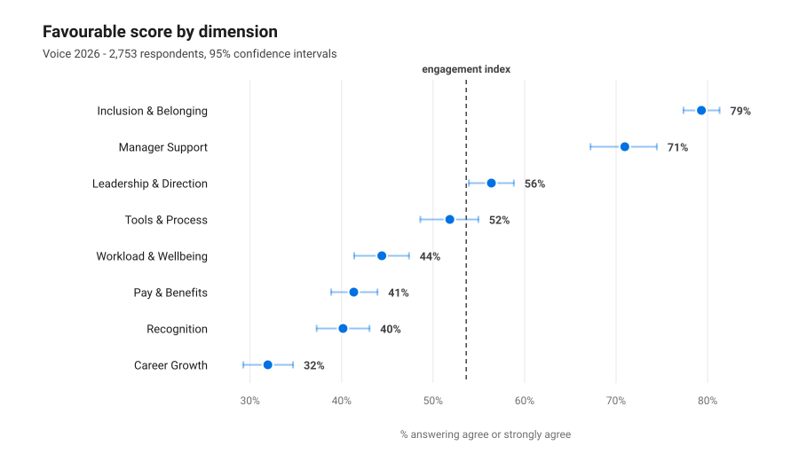
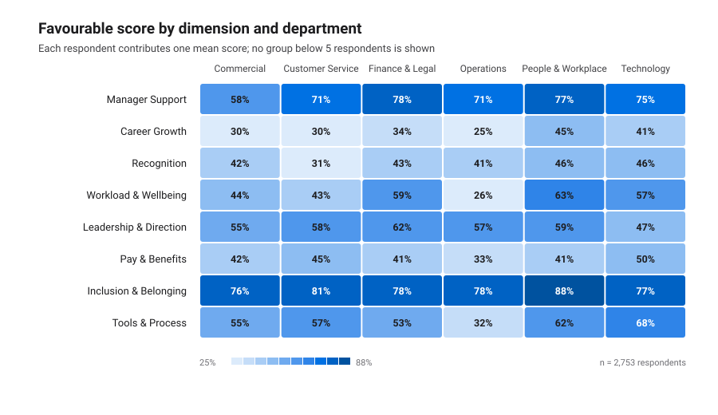
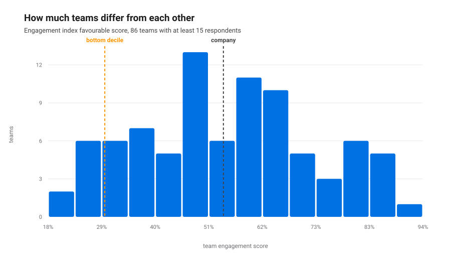
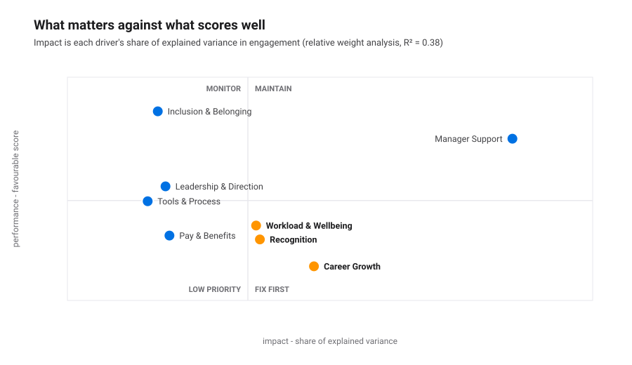
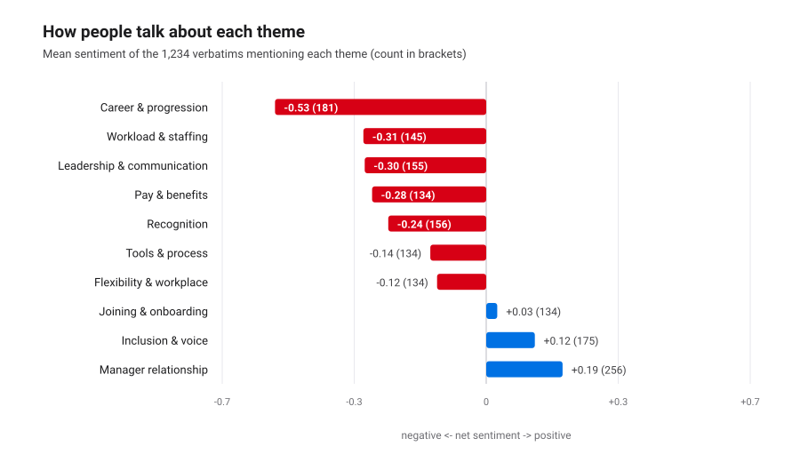
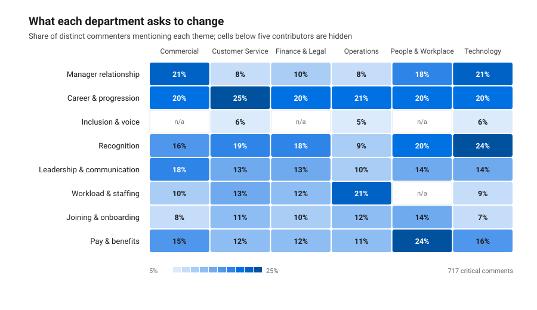

# Voice 2026 - survey read-out

**Fieldwork:** 4-22 May 2026
**Population:** a synthetic European services group - 3,800 employees, 149 teams,
four countries
**Generated by:** `python3 src/run_all.py` - every number, chart and quotation below is
reproduced from the code in this repository

> The survey, the answers and the comments are synthetic, generated with a fixed seed by
> `src/generate_survey.py`. No real employee ever wrote any of this. What is meant to be
> judged is the method: how participation is checked before results are quoted, how drivers
> are separated from noise, and how free text is scored before it is believed.

---

## 1. Participation and scores

**Voice 2026** ran 4-22 May 2026. **2,753 of 3,800** employees responded - **72.4%** (95% bootstrap interval 70.2%-74.5%).

### Who answered, and who did not

Response rate runs from **61% in Operations** to **83% in Finance &amp; Legal**. Shift workers answered at **57%** against **79%** for everyone else. That gap is not an administrative detail: it affects whose experience the results describe.

| Department | Invited | Responded | Rate | Share gap |
| :--- | ---: | ---: | ---: | ---: |
| Operations | 1,178 | 722 | 61% | -4.8 pp |
| Customer Service | 912 | 661 | 72% | +0.0 pp |
| Commercial | 532 | 419 | 79% | +1.2 pp |
| People &amp; Workplace | 342 | 270 | 79% | +0.8 pp |
| Technology | 494 | 397 | 80% | +1.4 pp |
| Finance &amp; Legal | 342 | 284 | 83% | +1.3 pp |

**Operations** is the most under-represented reportable group at **-4.8 pp**. Response-rate differences show coverage gaps, but they do not tell us what non-respondents would have said. Interpret the company score as a description of respondents, not the full workforce.

### The headline

| Measure | Result | Read |
| :--- | ---: | :--- |
| Engagement index | **54% favourable** | 95% bootstrap interval 50.5%-56.7%, 2,753 respondents |
| eNPS | **-12** | 22% promoters, 43% passives, 34% detractors |
| Response rate | **72.4%** | 2,753 of 3,800 invited |
| Teams reported | **144** | 5 suppressed for being below 5 respondents |

A negative eNPS means more people would actively warn a friend off working here than would recommend it. With 34% detractors, this is not a communications problem to be reframed; it is the thing the rest of the report has to explain.

### Dimension scores

| Dimension | Favourable | 95% bootstrap interval | Mean (1-5) | Respondents | Item answers |
| :--- | ---: | ---: | ---: | ---: | ---: |
| Inclusion &amp; Belonging | **79%** | 77%-81% | 4.17 | 2,753 | 8,259 |
| Manager Support | **71%** | 67%-74% | 4.00 | 2,753 | 11,012 |
| Leadership &amp; Direction | **56%** | 54%-59% | 3.59 | 2,753 | 8,259 |
| Tools &amp; Process | **52%** | 49%-55% | 3.48 | 2,753 | 5,506 |
| Workload &amp; Wellbeing | **44%** | 41%-47% | 3.28 | 2,753 | 8,259 |
| Pay &amp; Benefits | **41%** | 39%-44% | 3.20 | 2,753 | 5,506 |
| Recognition | **40%** | 37%-43% | 3.17 | 2,753 | 5,506 |
| Career Growth | **32%** | 29%-35% | 2.94 | 2,753 | 8,259 |

The observed spread is **Inclusion & Belonging** at 79% to **Career Growth** at 32%. The bootstrap intervals reflect sampling variation under the reported bootstrap unit; overlapping intervals do not support a firm ranking between dimensions.

### Where it differs by department

Cells show descriptive respondent-level means. The table lists the largest observed gaps below the company mean; no significance claims are made for these multiple cuts:

| Department | Dimension | Favourable | vs company mean |
| :--- | :--- | ---: | ---: |
| Operations | Tools &amp; Process | 32% | -20.0 pp |
| Operations | Workload &amp; Wellbeing | 26% | -18.0 pp |
| Commercial | Manager Support | 58% | -12.7 pp |
| Customer Service | Recognition | 31% | -9.6 pp |
| Technology | Leadership &amp; Direction | 47% | -9.4 pp |
| Operations | Pay &amp; Benefits | 33% | -8.1 pp |
| Operations | Career Growth | 25% | -7.3 pp |
| Commercial | Inclusion &amp; Belonging | 76% | -2.9 pp |
| Customer Service | Career Growth | 30% | -2.3 pp |
| Technology | Inclusion &amp; Belonging | 77% | -2.2 pp |

### The company average hides the teams

Across 86 teams with at least 15 respondents, respondent-level engagement ranges from **18%** to **94%**. The bottom decile sits at **29%** and the top at **80%** - a **51 percentage point** spread. These are descriptive signals for follow-up, not evidence that a manager or team caused the difference.

**5 teams are suppressed** because they have fewer than 5 respondents.

**19 teams have a 95% within-team bootstrap interval below the observed company mean. This is an exploratory screen, not a significance test: team comparisons are not adjusted for multiplicity and the company mean includes each team.** The ten lowest descriptive results:

| Team | Department | Respondents | Engagement index | 95% bootstrap interval |
| :--- | :--- | ---: | ---: | ---: |
| T147 | People &amp; Workplace | 30 | 18% | 8%-29% |
| T091 | Commercial | 35 | 21% | 11%-32% |
| T117 | Technology | 25 | 24% | 13%-37% |
| T042 | Operations | 17 | 25% | 12%-39% |
| T023 | Operations | 28 | 26% | 15%-39% |
| T057 | Customer Service | 16 | 27% | 17%-38% |
| T055 | Customer Service | 25 | 28% | 15%-40% |
| T095 | Commercial | 21 | 29% | 17%-41% |
| T075 | Customer Service | 25 | 29% | 19%-41% |
| T078 | Customer Service | 17 | 29% | 14%-45% |

## 2. What actually drives engagement

Eight dimensions explain **38%** of the variation in the engagement index across 2,753 respondents. Below, *impact* is each dimension's share of that explained variance, and *performance* is its favourable score.

| Dimension | Impact | 90% bootstrap range | Rank range | Favourable | Correlation | Std. beta |
| :--- | ---: | ---: | ---: | ---: | ---: | ---: |
| Manager Support | **40%** | 35%-45% | 1 | 71% | 0.48 | +0.34 |
| Career Growth | **19%** | 17%-22% | 2-4 | 32% | 0.39 | +0.19 |
| Recognition | **14%** | 11%-16% | 2-4 | 40% | 0.33 | +0.14 |
| Workload &amp; Wellbeing | **13%** | 10%-16% | 3-4 | 44% | 0.32 | +0.17 |
| Pay &amp; Benefits | **4%** | 3%-6% | 5-8 | 41% | 0.22 | +0.07 |
| Leadership &amp; Direction | **4%** | 2%-6% | 5-8 | 56% | 0.20 | +0.07 |
| Inclusion &amp; Belonging | **3%** | 2%-4% | 5-8 | 79% | 0.20 | +0.04 |
| Tools &amp; Process | **2%** | 1%-4% | 5-8 | 52% | 0.19 | +0.01 |

**Manager Support** carries **40%** of the explained variance, more than the bottom four dimensions combined (14%). **Tools & Process** carries **2%** - it is not unimportant to people, it is simply not what separates an engaged employee from a disengaged one here.

### How much of this ranking can we trust

The weights were recomputed on **120 valid team-cluster bootstrap resamples**. The rank range column shows where each dimension landed across those runs.

**Manager Support** finished first in every single resample, so the headline of this analysis is not a sampling artefact. **Career Growth** and **Recognition** never fell below 4th, so they are the second tier - but they trade places with each other, and arguing about which of them is second is arguing about noise. **Pay & Benefits**, **Leadership & Direction**, **Inclusion & Belonging** and 1 others move by two or more places between resamples. Their order relative to each other is not a finding, and a read-out that calls one of them 'the fifth priority' is reading noise.

### The priority quadrant

High impact and a low score is the only quadrant that earns investment: **Career Growth** (19% impact, 32% favourable), **Recognition** (14% impact, 40% favourable), **Workload & Wellbeing** (13% impact, 44% favourable).

Compare that with **Pay & Benefits** at 41% favourable but only 4% impact. Pay is the loudest complaint in the free text and one of the lowest scores in the survey, and it still is not what moves engagement in this company. A pay review would buy goodwill; it would not buy engagement. That is an uncomfortable finding to present, which is exactly why it needs the bootstrap behind it.

### What the gap is worth

Among 129 teams with at least 10 complete respondents, those in the top quartile on Manager Support score **72%** on the engagement index, against **36%** for the bottom quartile - a descriptive **37 percentage point** difference. This is an observed, unadjusted contrast between teams, not evidence that changing the driver would cause the difference.

## 3. What people wrote

**1,234 comments** from **879 of 2,753** respondents (32%). Detractors wrote reportable comments at **0.34 per detractor** and promoters at **0.18 per promoter** (1.9 times the promoter rate). Comment participation differs between eNPS groups, so theme frequencies are descriptive and should not be read as workforce prevalence.

### First: does the text pipeline actually work?

Theme tagging uses a keyword lexicon that lives in [`src/textlib.py`](../src/textlib.py) and can be read, argued with and changed. It tagged at least one theme on **97%** of comments. This synthetic corpus has hand-labelled references for 1,234 comments:

| Theme | Precision | Recall | F1 | False positives | Misses |
| :--- | ---: | ---: | ---: | ---: | ---: |
| Career &amp; progression | 1.00 | 1.00 | **1.00** | 0 | 0 |
| Flexibility &amp; workplace | 1.00 | 1.00 | **1.00** | 0 | 0 |
| Inclusion &amp; voice | 1.00 | 1.00 | **1.00** | 0 | 0 |
| Joining &amp; onboarding | 1.00 | 1.00 | **1.00** | 0 | 0 |
| Recognition | 1.00 | 1.00 | **1.00** | 0 | 0 |
| Leadership &amp; communication | 0.84 | 1.00 | **0.91** | 25 | 0 |
| Workload &amp; staffing | 0.83 | 1.00 | **0.91** | 25 | 0 |
| Pay &amp; benefits | 1.00 | 0.81 | **0.90** | 0 | 31 |
| Tools &amp; process | 0.77 | 1.00 | **0.87** | 32 | 0 |
| Manager relationship | 0.66 | 0.89 | **0.76** | 89 | 21 |

Macro F1 is **0.93**. The weakest theme is **Manager relationship** (F1 0.76, 89 false positives): comments about something else that mention a manager in passing get pulled in. That is the honest cost of a keyword approach, and the reason the themes are reported as a ranked shape of the conversation rather than as exact counts.

*These demo comments are assembled from a template bank, which makes a keyword lexicon's job easier than on real free text. The measured scores are not an estimate of performance on employee comments.*

Sentiment is a word list with negation handling, not a language model. On this synthetic labelled corpus it gets **67%** of negative comments right, **71%** of positive comments right. Across 878 respondents with comments and eNPS, mean comment sentiment correlates descriptively at **r = 0.28** with eNPS. This is not an external validation and is not used to infer individual attitudes.

### Volume and tone by theme

| Theme | Distinct commenters | Share of commenters | Mean sentiment |
| :--- | ---: | ---: | ---: |
| Manager relationship | 256 | 29% | +0.19 |
| Career &amp; progression | 181 | 21% | -0.53 |
| Inclusion &amp; voice | 175 | 20% | +0.12 |
| Recognition | 156 | 18% | -0.24 |
| Leadership &amp; communication | 155 | 18% | -0.30 |
| Workload &amp; staffing | 145 | 16% | -0.31 |
| Joining &amp; onboarding | 134 | 15% | +0.03 |
| Pay &amp; benefits | 134 | 15% | -0.28 |
| Tools &amp; process | 134 | 15% | -0.14 |
| Flexibility &amp; workplace | 134 | 15% | -0.12 |

### Where the complaints concentrate

| Theme | Share of detractor commenters | Share of promoter commenters | Ratio |
| :--- | ---: | ---: | ---: |
| Manager relationship | 16% | 9% | **1.7x** |
| Recognition | 18% | 16% | **1.2x** |
| Joining &amp; onboarding | 11% | 9% | **1.1x** |
| Workload &amp; staffing | 12% | 11% | **1.1x** |
| Inclusion &amp; voice | 4% | 5% | **0.9x** |
| Career &amp; progression | 21% | 25% | **0.8x** |

**Manager relationship** appears in 16% of detractor commenters against 9% of promoter commenters - **1.7 times** as often. This descriptive contrast is exploratory.

### Do the words agree with the numbers?

Across 44 eligible department-and-theme combinations, the share of distinct commenters raising a theme correlates descriptively at **r = -0.55** with the favourable score on the matching survey dimension. This is an exploratory cross-check, not evidence that both measures are valid or that text represents the workforce.

### The language each department uses

| Department | Distinctive terms in their 'what should change' comments |
| :--- | :--- |
| Commercial | `access`, `tool`, `takes week`, `avoids`, `problems` |
| Customer Service | `role`, `route`, `training`, `budget`, `exists` |
| Finance &amp; Legal | `role`, `hire`, `externally`, `inside`, `grow` |
| Operations | `firefighting`, `capacity`, `planned`, `access`, `tool` |
| People &amp; Workplace | `training`, `budget`, `exists`, `paper`, `postponed` |
| Technology | `role`, `kept`, `inflation`, `running`, `two year` |

These terms are weighted by how much more one group uses them than others.

### In their own words

Verbatims are published only from groups with at least 5 distinct respondents; automated redaction is imperfect and does not make source comments anonymous.

**Manager relationship**
> "The main issue is that leadership talks about transparency and then reorganises without warning. Otherwise this is a good place to work. My manager avoids difficult conversations, so problems in the team just continue."
>
> — Commercial, 10 years + tenure
>
> "The main issue is that the approval process takes longer than the work itself. Otherwise this is a good place to work. Recognition stops at my manager and never travels further up."
>
> — Operations, 10 years + tenure
>

**Career & progression**
> "The main issue is that good work is expected and never mentioned; mistakes are mentioned immediately. This needs fixing this year. Training budget exists on paper but every request gets postponed."
>
> — Operations, 3-5 years tenure
>
> "Honestly, recognition stops at my manager and never travels further up. It should not be this hard. Promotions here go to people who are visible to leadership, not to people who deliver."
>
> — Customer Service, 6-10 years tenure
>

**Inclusion & voice**
> "The office rules changed twice this year with no explanation. The rest of my experience here is positive. Everything important is decided in English at a speed that excludes half the room."
>
> — Operations, 3-5 years tenure
>
> "The office rules changed twice this year with no explanation. Otherwise this is a good place to work. The same voices dominate every meeting and the rest of us stop trying."
>
> — Finance & Legal, 6-10 years tenure
>

**Recognition**
> "The main issue is that good work is expected and never mentioned; mistakes are mentioned immediately. This needs fixing this year. Training budget exists on paper but every request gets postponed."
>
> — Operations, 3-5 years tenure
>
> "The approval process takes longer than the work itself. Otherwise this is a good place to work. Recognition stops at my manager and never travels further up."
>
> — Customer Service, < 1 year tenure
>

---

## Method, assumptions and limits

**Favourable scoring.** Each respondent contributes one favourable share per score or
dimension, so people who answered more items do not count as more independent evidence.
95% intervals for company and department means resample teams when multiple teams contribute;
one-team subsets resample respondents. Team scores resample respondents within their team.
These intervals show sampling variation under this design; they do not correct non-response
bias or turn exploratory cuts into causal findings.

**Confidentiality.** Reported aggregate cells require at least **5 respondents**.
The public synthetic demo embeds row-level synthetic data so filters work offline. Local
mode omits free text and rare filter labels, and withholds team identifiers from reports;
its optional HTML still embeds respondent-level scores and segment indexes. The local file
is confidential and is not an access-control mechanism.

**Key driver analysis.** Engagement is modelled from the eight dimension scores using
Johnson's relative weight analysis. Ordinary regression coefficients are unstable when
predictors are as correlated as survey dimensions are: they hand shared variance to
whichever driver wins a near-tie. Relative weights split the explained variance sensibly,
and a **bootstrap over resampled teams** shows which parts of the resulting ranking survive
resampling and which do not. Standardised betas and simple correlations are
reported alongside, so the reader can see all three agree on the top of the list.

**Group comparisons.** Department and team cuts are descriptive. They use respondent-level
means and intervals, but do not claim statistical significance and are not adjusted for
multiple comparisons. The company mean includes the teams being compared.

**Free text.** Themes are assigned by a keyword lexicon and sentiment by a word list with
negation handling - both in `src/textlib.py`, both readable and arguable. Neither is a language model, and the report
states the measured precision, recall and error rates before drawing on the results. Comments are analysed only in
aggregate; nothing is ever inferred about an individual, and verbatims are published only from groups above the
threshold, after an automated pass that strips names, emails and phone numbers.

**Limits.** One survey, one moment, one organisation. Cross-sectional data cannot establish
that improving a driver *causes* engagement to rise - the driver analysis ranks
associations, and the report says so wherever a number could be read as a promise.
Non-response is not random: the groups least likely to answer are the ones under most
pressure, so company-level scores are more likely to be flattering than harsh.
